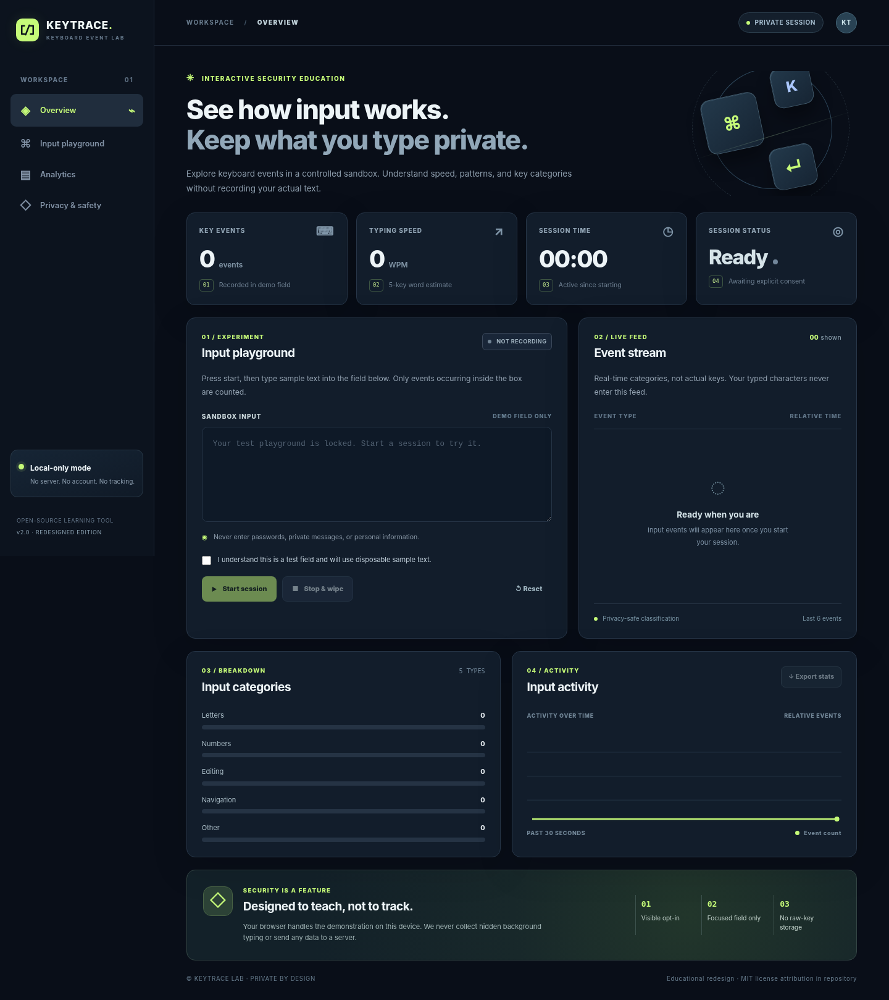
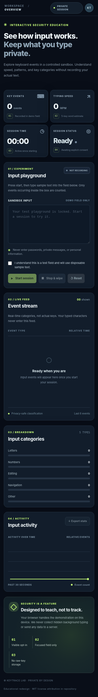

# KEYTRACE — Keyboard Event Lab

**Explore how keyboard input works. Keep what you type private.**

KEYTRACE is a privacy-focused cybersecurity education project featuring a responsive web dashboard and a Python desktop lab. It demonstrates keyboard event categories, typing activity, and estimated typing speed **inside a visible, opt-in test field**.

Unlike a system-wide keylogger, KEYTRACE does **not** monitor other applications or capture hidden background keystrokes.



## Features

| Feature | Description |
| --- | --- |
| **Interactive dashboard** | Responsive dark interface, custom icon, metric cards, and live activity visualizations. |
| **Opt-in typing playground** | Requires explicit consent and a Start action before counting events in the demo field. |
| **Live metrics** | Tracks key-event count, estimated words per minute (WPM), and session duration. |
| **Event categories** | Groups input as letters, numbers, editing, navigation, or other controls. |
| **Activity visualization** | Displays recent input activity and category distribution. |
| **Privacy-aware event feed** | Shows event categories and relative times, not the typed characters. |
| **Export statistics** | Downloads a JSON summary containing aggregate counts rather than raw text. |
| **Desktop companion** | Tkinter app with a visible, window-scoped typing sandbox. |
| **Automated tests** | Python and JavaScript tests run through GitHub Actions. |

## Screenshots

| Desktop dashboard | Mobile dashboard |
| --- | --- |
|  |  |

## Technology stack

- **Frontend:** HTML5, CSS3, and vanilla JavaScript
- **Charts:** HTML Canvas API
- **Desktop app:** Python 3.10+ and Tkinter
- **Testing:** Python `unittest` and Node.js built-in test runner
- **CI:** GitHub Actions
- **Web hosting:** Vercel (static site)

The website requires **no framework, npm packages, backend, database, or API keys**.

## Project structure

```text
KEYTRACE/
├── .github/
│   └── workflows/
│       └── test.yml                 # Python and JavaScript CI tests
│
├── docs/
│   ├── dashboard-preview.png        # Desktop dashboard screenshot
│   └── mobile-preview.png           # Mobile dashboard screenshot
│
├── keyboard_lab/
│   ├── __init__.py                  # Python package exports
│   └── session.py                   # Session state and keyboard metrics
│
├── tests/
│   └── test_session.py              # Python unit tests
│
├── web/
│   ├── assets/
│   │   ├── icon.png                 # App / touch icon
│   │   └── icon.svg                 # Website favicon
│   ├── app.js                       # Dashboard controls and visualization
│   ├── index.html                   # Main web dashboard
│   ├── metrics.js                   # Keyboard statistics utilities
│   ├── metrics.test.cjs             # JavaScript unit tests
│   └── styles.css                   # Responsive styling
│
├── .gitignore                       # Ignore generated and local files
├── keylogger.py                     # Tkinter desktop application
└── README.md                        # Project documentation
```

> **Note:** `__pycache__/` is a Python-generated folder and is excluded by `.gitignore`. It is not part of the tracked project structure.

## Getting started

### Prerequisites

- Python **3.10 or later** for the desktop app or optional local web server
- A modern web browser (Chrome, Firefox, Safari, or Edge)
- **Optional:** Node.js to run JavaScript tests

### 1. Clone the repository

```bash
git clone https://github.com/23-shivamsingh/KEYTRACE.git
cd KEYTRACE
```

### 2. Run the web dashboard

From the project root, start a static development server:

```bash
python3 -m http.server 8000
```

Open **http://localhost:8000/web/** in your browser.

The website also supports directly opening `web/index.html`. The Python command above only serves static files; it does not create an API or collect keyboard events.

### 3. Try an interactive session

1. Check the consent box under **Input playground**.
2. Click **Start session**.
3. Type disposable example text in the designated input box.
4. Review the event counts, WPM estimate, event categories, and activity chart.
5. Click **Stop & wipe** to stop counting and clear the visible sample text.
6. Use **Reset** to clear session metrics, or **Export stats** to download aggregate JSON statistics.

**Do not enter passwords, personal data, or sensitive messages into the demo field.**

## Run the desktop application

Launch the Python/Tkinter lab from the project root:

```bash
python3 keylogger.py
```

On Windows, `py keylogger.py` may be used instead.

The desktop application has its own **Start demo**, **Stop & wipe**, **Export stats**, and **Reset** controls. Keyboard events are counted only inside the app's visible typing sandbox; it does not install a global keyboard listener.

If Tkinter is missing, install or enable a Python distribution with Tk support. On macOS, you can check availability using `python3 -m tkinter`.

## Run automated tests

Run the Python tests:

```bash
python3 -m unittest discover -s tests -v
```

Run the JavaScript tests (Node.js required):

```bash
node --test web/metrics.test.cjs
```

The `.github/workflows/test.yml` workflow runs both test suites automatically on pushes and pull requests. It also checks that the Python implementation does not import a system-wide `pynput` key listener.

## Deploy the website with Vercel

KEYTRACE's browser dashboard is a static site. To deploy it from GitHub:

1. Open [Vercel](https://vercel.com/new) and import **`23-shivamsingh/KEYTRACE`**.
2. Set **Root Directory** to **`web`**.
3. Select **Framework Preset: Other**.
4. Leave **Build Command**, **Output Directory**, and **Install Command** overrides disabled.
5. Leave **Environment Variables** empty.
6. Click **Deploy** and use the production URL Vercel assigns.

Once connected, pushes to the configured production branch can trigger new deployments.

> **Deployment scope:** Vercel hosts only the `web/` dashboard. The Python desktop app runs locally and is not part of the hosted website. No API server or WebSocket endpoint is required.

## Privacy and limitations

- **Visible input only:** Events are counted only while a session is active and the designated typing field is focused.
- **No system-wide monitoring:** The project does not listen for keystrokes from other windows or apps.
- **No hidden collection:** The event feed stores category labels and relative timing rather than the actual typed characters.
- **Local processing:** The web demonstration runs in your browser; it does not send typing data to a server.
- **Temporary sample text:** Text remains visible in the active typing field until you clear it; **Stop & wipe** clears that field.
- **Aggregate exports:** Exported JSON includes summary statistics, not raw typed text.
- **Approximate WPM:** Typing speed uses a simplified five-keystrokes-per-word estimate; it is not a clinical or standardized typing assessment.


---

**KEYTRACE — Designed to teach, not to track.**